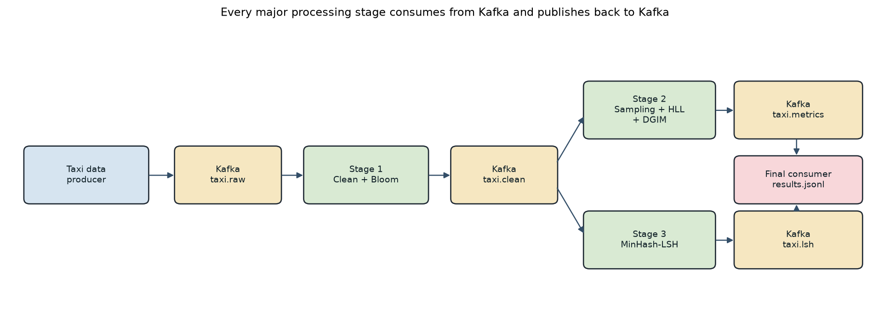

# Taxi stream analytics

A small Kafka pipeline that replays a rush-hour slice of NYC yellow taxi trips and checks approximate algorithms against exact answers on the same stream.

Pickup zones are compared with MinHash and locality-sensitive hashing. Fares, routes, and slow trips are tracked with a reservoir, HyperLogLog, and DGIM. The interesting part is not a higher events-per-second number. It is what stays correct when partitions, keys, and producer speed change.



## What a reader should take from the measurements

Measured on a laptop (i7-1255U, 16 GB, Kafka in Docker, Python on the host), same 16,000 trips:

- **Six consumers do not beat four.** The topic has 4 partitions, so 2 of the 6 consumers sit idle and throughput does not rise.
- **A zone key is a trade.** Keying by pickup zone puts 33.5% of messages on the busiest partition, but each zone stays intact. Round-robin is flatter (25.6%) and splits 81 zones, so destination sets have to be merged before similarity search. A partition-local Bloom filter then misses 70% of intentional duplicates.
- **Speed changes lag, not the sketch.** An unlimited producer reaches about 11,200 events/s and about 12,000 messages of lag. HyperLogLog error stays near 2%. LSH recall falls because 2,933 late trips miss their hour, not because the sketch got worse.

Full table: [`results/experiment_summary.csv`](results/experiment_summary.csv).

## Pipeline

The file is read only by the producer. After that, every stage reads a Kafka topic and writes a Kafka topic.

| Stage | Reads | Writes | Job |
| --- | --- | --- | --- |
| Producer | taxi CSV | `taxi.raw` | Replay in pickup-time order, with a set rate, 2% duplicates, and 2% delayed sends |
| Clean | `taxi.raw` | `taxi.clean` | Validate, add route and duration, mark Bloom-filter hits without dropping the event |
| Metrics | `taxi.clean` | `taxi.metrics` | Reservoir, event vs entity sampling, HyperLogLog, DGIM, exact baselines |
| Similarity | `taxi.clean` | `taxi.lsh` | Destination sets by pickup zone, MinHash-LSH, exact Jaccard on candidates |
| Report | both output topics | `results/results.jsonl` | One JSON object per hour, plus a console line |

Sketches are implemented in this repo (Bloom, DGIM, HyperLogLog, MinHash) so the parameters are visible. Stage 2 is one consumer because those sketches are global. Stage 1 is the consumer group whose size the partition experiments change.

## Results on one hour (4 Jan 2024, 16:00–17:00)

**HyperLogLog** (precision 12): 2,198 distinct routes, estimate 2,229, error 1.4%. The sketch is 4 KB. The exact key set is about 156 KB and grows with the number of routes.

**Reservoir** (k = 1,000): mean fare 19.17 exact vs 20.06 sampled (4.7%). Mean distance 3.21 vs 3.36 (4.9%). Sizes 100 and 10,000 are in the same report.

**Diversity.** A pickup zone is diverse if it has trips to at least 10 drop-off zones. Exact fraction of active zones: 0.43. Sampling 10% of *trips* gives 0.35, because a thin sample never reaches 10 destinations. Sampling 10% of *zones* and keeping every trip for those zones gives 0.57. The second error is variance. The first is a biased statistic. That is why a non-linear, per-entity question should not be answered from a sample of events.

**DGIM** on the slow-trip bit, most recent 10,000 events. All three queries stay inside the 50% bound:

| Window | Exact 1s | Estimate | Error |
| ---: | ---: | ---: | ---: |
| 1,000 | 141 | 192 | 36% |
| 5,000 | 674 | 768 | 14% |
| 10,000 | 1,024 | 768 | 25% |

**Bloom filter.** Sized for 200,000 ids at a 1% false-positive target (1.9 million bits, 7 hashes), this volume produced no false positive and no false negative. A smaller filter (1,580 bits, 3 hashes) did: false-positive rate 0.81, example event `2024-01-row-00000018`. The event was kept. A Bloom hit is not proof.

**MinHash-LSH.** 53 active pickup zones, 1,378 possible pairs, 281 pairs with Jaccard at least 0.50.

| Banding | Candidates | Recall | Candidate precision | Pairs avoided | Build time | All-pairs time |
| --- | ---: | ---: | ---: | ---: | ---: | ---: |
| 20 bands × 5 rows | 360 | 0.77 | 0.60 | 74% | 121 ms | 12 ms |
| 10 bands × 10 rows | 16 | 0.05 | 0.88 | 99% | 129 ms | 12 ms |

Zones 43 and 48 are one retained pair, exact Jaccard 0.61. Ten rows per band only collides sets whose similarity is near 1, so almost every pair at the 0.50 cutoff is missed. Twenty by five sits on that cutoff. All-pairs was faster here because 53 zones is a small comparison. LSH cuts the pairs you verify. It saves CPU when there are many more zones.

## Load, lateness, restart

Same 16,000 trips, 4 partitions, 4 consumers.

| Input | Produced/s | Processing p50 / p95 | Max lag | HLL error | LSH recall | Late trips dropped |
| --- | ---: | --- | ---: | ---: | ---: | ---: |
| 100/s | 100 | 144 ms / 390 ms | 50 | 2.0% | 0.72 | 17 |
| 1,000/s | 1,000 | 302 ms / 1.1 s | 556 | 2.1% | 0.73 | 264 |
| Unlimited | 11,206 | 4.5 s / 11 s | 11,951 | 1.7% | 0.66 | 2,933 |

The watermark is 20 seconds behind the latest event time. Trip `2024-01-row-00000159` (16:01) was still inside the open hour and was counted. Trip `2024-01-row-00003792` (16:30) arrived after that hour had closed and was dropped from the hourly sketches. Report latency, measured to the hour’s close, is actually *higher* at the slow rate (49 s vs 13 s) because the hour takes longer to finish. Processing latency is the number that tracks overload.

Killing the metrics stage froze its committed offset. Lag rose from 656 to 2,505 while it was down, then returned to 0 after restart. The new process read only the uncommitted suffix, because the sketches live in memory. 944 event ids were applied twice. Commits are at-least-once.

## Run

Requires Docker and Python 3.12.

```bat
run_all.bat
```

That installs dependencies, starts Kafka, and replays up to 20,000 trips at 1,000 events/s. Hourly reports append to `results/results.jsonl`.

`run_experiments.bat` rebuilds the comparison table. It takes about 15 minutes. Knobs are in `config.yaml`: `producer_rate` (`0` means unlimited), `partitions`, `consumers`, and `partition_key` (`pickup_zone` or `none`).

`data/taxi_sample.csv` is the busiest four hours of NYC TLC yellow trips on 4 January 2024 (31,880 rows, 16:00–20:00). `scripts/prepare_data.py` rebuilds it from the TLC parquet.

## Layout

```
producer/                  taxi CSV to taxi.raw
stage1_clean_bloom/        taxi.raw to taxi.clean
stage2_stream_analytics/   taxi.clean to taxi.metrics
stage3_lsh/                taxi.clean to taxi.lsh
final_consumer/            both outputs to results.jsonl
common/                    Bloom, DGIM, HyperLogLog, MinHash, Kafka helpers
config.yaml                one file for rate, partitions, sketch size, LSH bands
```
